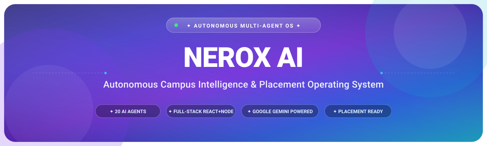
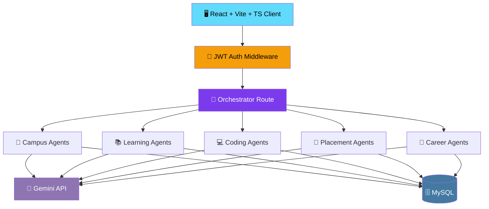
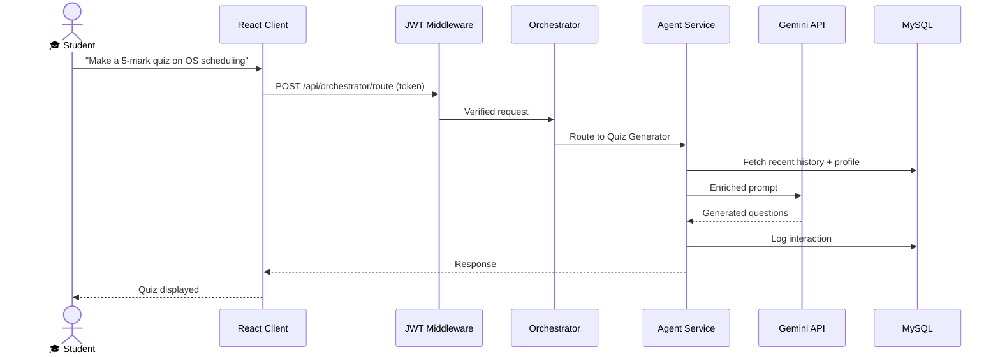
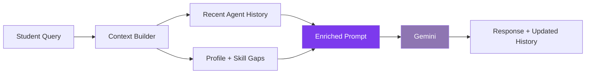

<div align="center">



### 🤖 Not a chatbot. Not an ERP. An AI Operating System for Students.

<a href="https://github.com/HareshK-14/NEROX-AI">
  
</a>

<br/>

[](https://react.dev)
[](https://vitejs.dev)
[](https://www.typescriptlang.org)
[](https://nodejs.org)
[](https://expressjs.com)
[](https://www.mysql.com)
[](https://ai.google.dev)
[](https://jwt.io)

<br/>

[😟 Problem](#-the-problem) · [💡 Solution](#-the-solution) · [🧩 Hubs](#-the-5-hubs) · [🤖 Agents](#-ai-agents) · [📸 Screenshots](#-screenshots) · [🏗️ Architecture](#%EF%B8%8F-architecture) · [📡 API](#-api-endpoints) · [🚀 Quick Start](#-quick-start) · [🗺️ Roadmap](#%EF%B8%8F-roadmap)

</div>

---

## 😟 The Problem

> *"Where's my timetable? Which company should I target? Why is my code failing? What should I revise tonight?"*

A student's day is spread across **many disconnected tools**:

| 😕 Today | Result |
|---|---|
| Attendance, fees and timetable live in separate portals | Time wasted finding basic info |
| Study material is generic and static | No personalised learning |
| Mock tests are the same for every company | No real placeholder for company-specific prep |
| Nobody tracks the *whole* journey | Students don't know how ready they actually are |

## 💡 The Solution

**NEROX AI** puts everything behind one conversational layer. A student asks in plain language, and an **Orchestrator** routes the query to the right specialised agent.

```
                    🎓 "Generate a 5-mark quiz on OS scheduling"
                                      │
                                      ▼
                            🔀  ORCHESTRATOR
                  ┌──────────┬────────┴───────┬──────────┐
                  ▼          ▼                ▼          ▼
              🏫 Campus  📚 Learning       💻 Coding   🎯 Placement   🧭 Career
                             │
                             ▼
                      📝 Quiz Generator Agent
                             │
                             ▼
                  ✅ Questions + history saved
```

---

## ✨ Why It Stands Out

| 🔀 Smart routing | 🧠 Context-aware | 🎯 Placement-focused | 📊 One score |
|---|---|---|---|
| Orchestrator picks the right agent automatically | Agents use recent history and profile, not generic replies | Company-specific readiness, tests and strategy | A single Success Score to track progress |

---

## 🧩 The 5 Hubs

| Hub | What students get |
|---|---|
| 🏫 **Campus Hub** | Attendance, fees, timetable, library and events in one AI-answered feed |
| 📚 **Smart Learning Hub** | Concept tutoring, PDF to notes/flashcards, quiz generation, revision plans |
| 💻 **Coding Hub** | AI mentor for debugging and optimisation, adaptive Java/Python/SQL tests |
| 🎯 **Placement Intelligence Hub** | Readiness scoring, company tests, GD coaching, 30/60/90-day strategy |
| 🧭 **Career Hub** | Career paths, certification suggestions, skill-gap analysis |

---

## 🤖 AI Agents

<details open>
<summary><b>🏫 Campus Hub (4)</b></summary>

| Agent | Function |
|---|---|
| Helpdesk Agent | Attendance, fees, exams, college FAQ |
| Timetable Agent | Today's classes, exam schedule |
| Library Agent | Book search, recommendations, summaries |
| Events Agent | Hackathons, workshops, registration |

</details>

<details>
<summary><b>📚 Smart Learning Hub (4)</b></summary>

| Agent | Function |
|---|---|
| Smart Tutor | Concept explanations, examples, notes |
| Notes Intelligence | PDF to Summary, Flashcards, Mind Map |
| Quiz Generator | MCQ, 2M, 5M, 10M, Viva questions |
| Revision Planner | Daily, weekly and exam study plans |

</details>

<details>
<summary><b>💻 Coding Hub (3)</b></summary>

| Agent | Function |
|---|---|
| Coding Mentor | Explain, debug, optimise, complexity |
| Debug Agent | Error detection, fix, better code |
| Coding Test Agent | Adaptive Java/Python/SQL tests |

</details>

<details>
<summary><b>🎯 Placement Intelligence Hub (8)</b></summary>

| Agent | Function |
|---|---|
| Company Readiness | Company-specific readiness score |
| Company Explorer | Company profiles, process, salary |
| Test Generator | Company-specific full test papers |
| Coding Evaluator | Performance analysis and suggestions |
| GD Coach | Topic generation and evaluation |
| Placement Analytics | Placement dashboard |
| Strategy Agent | 30/60/90-day preparation plans |
| Daily Mission | Daily coding/aptitude challenges |

</details>

<details>
<summary><b>🧭 Career Hub (2)</b></summary>

| Agent | Function |
|---|---|
| Career Advisor | Paths, certifications, internships |
| Skill Gap Agent | Current vs target role gap analysis |

</details>

---

## 📸 Screenshots

> 👉 Add real images in `docs/screenshots/` and keep these file names.

<div align="center">

| 🏠 Dashboard | 💬 Agent Chat |
|:---:|:---:|
|  |  |

| 🎯 Placement Analytics | 📝 Quiz Generator |
|:---:|:---:|
|  |  |

### 🎬 Demo


</div>

---

## 🏗️ Architecture



### 🔄 Request Flow



---

## 🛡️ Advanced Capabilities

### 🧠 Agent Context Memory

Agents are not stateless. Each request is enriched with the student's recent history and profile before it reaches Gemini.



### ⚡ Rate Limiting & Caching

| Control | Behaviour |
|---|---|
| Per-user rate limit | Throttles rapid-fire requests to an agent |
| Response cache | Repeat prompt + context in a short window returns the cached result |
| Graceful fallback | On Gemini timeout/error, the student gets a clear retry message |

### 📊 Success Score

One number that summarises a student's placement readiness:

| Component | Weight |
|---|---|
| 💻 Coding Test Average | `███████░░░` **35%** |
| 🎤 Mock Interview / GD Score | `█████░░░░░` **25%** |
| 🏢 Company Readiness Score | `█████░░░░░` **25%** |
| 🔥 Daily Mission Consistency | `███░░░░░░░` **15%** |

```
Success Score = (Coding × 0.35) + (GD/Interview × 0.25) + (Readiness × 0.25) + (Consistency × 0.15)
```

Exposed via `GET /api/analytics/success-score`.

### 🔐 Security

| Signal | Applied at | Purpose |
|---|---|---|
| JWT verification | All `/api/*` routes except auth | Confirms a logged-in student |
| Input validation | `middleware/validate` | Rejects malformed payloads early |
| Upload restrictions | `middleware/upload` (Multer) | Limits file type and size for PDF uploads |
| Password hashing | `bcryptjs` | No plain-text passwords |
| Env isolation | `.env` (gitignored) | Keeps `JWT_SECRET` and `GEMINI_API_KEY` out of the repo |

---

## 🧗 Challenges & What I Learned

| Challenge | How I handled it |
|---|---|
| Routing a free-text query to the right one of 20+ agents | Built a single Orchestrator route that classifies intent and dispatches |
| Keeping AI answers consistent across a session | Added a context builder using recent history and profile |
| Controlling API cost and failures | Per-user rate limits, caching and graceful fallbacks |
| One score for a many-part journey | Designed a weighted Success Score across coding, GD, readiness and consistency |

**Skills practiced:** multi-agent design · prompt engineering · REST API design · JWT auth · relational schema design (13 tables) · TypeScript/React UI

---

## 🎨 Design System

| Aspect | Choice |
|---|---|
| Theme | Dark (always-on) |
| Colours | Indigo `#6366f1` · Violet `#8b5cf6` · Cyan `#06b6d4` |
| Style | Glassmorphism + Aurora gradients |
| Typography | Space Grotesk + Inter |
| Animation | Framer Motion + CSS keyframes |
| Charts | Recharts (dark theme) |

---

## 📁 Project Structure

```
nerox-ai/
├── frontend/                  React + Vite + TypeScript
│   └── src/
│       ├── components/        layout/ (Sidebar, Navbar) · ui/ (GlassCard, Charts)
│       ├── context/           Auth, Theme, Agent contexts
│       ├── pages/             10 pages
│       └── api/               Axios API modules
└── backend/                   Node.js + Express
    ├── src/
    │   ├── config/            DB + Gemini config
    │   ├── controllers/       10 controller modules
    │   ├── services/          AI agent services
    │   ├── routes/            10 route modules
    │   ├── middleware/        auth · upload · validate
    │   └── utils/             Response helpers
    └── database/
        └── schema.sql         MySQL schema (13 tables)
```

---

## 📡 API Endpoints

<details>
<summary><b>👉 Click to view all endpoints</b></summary>

```
AUTH
POST   /api/auth/register
POST   /api/auth/login
GET    /api/auth/me

PROFILE
GET    /api/profile
PUT    /api/profile
POST   /api/profile/skill
DELETE /api/profile/skill/:id

CAMPUS
POST   /api/campus/helpdesk
POST   /api/campus/timetable
POST   /api/campus/library
POST   /api/campus/events

LEARNING
POST   /api/learning/tutor
POST   /api/learning/notes
POST   /api/learning/quiz
POST   /api/learning/revision

CODING
POST   /api/coding/mentor
POST   /api/coding/debug
POST   /api/coding/test

PLACEMENT
POST   /api/placement/readiness
POST   /api/placement/company
POST   /api/placement/test
POST   /api/placement/gd
GET    /api/placement/analytics
POST   /api/placement/strategy

CAREER
POST   /api/career/advise
POST   /api/career/skill-gap

ANALYTICS & MISSIONS
GET    /api/analytics/success-score
GET    /api/analytics/history
GET    /api/mission/daily
POST   /api/mission/complete
GET    /api/mission/points

ORCHESTRATOR
POST   /api/orchestrator/route
```

</details>

---

## 🚀 Quick Start

**Prerequisites:** Node.js 18+, MySQL 8+, a Google Gemini API key

<details>
<summary><b>👉 Click to expand setup steps</b></summary>

<br/>

**1 · Clone and set up the database**
```bash
git clone https://github.com/HareshK-14/NEROX-AI.git
cd NEROX-AI
mysql -u root -p < backend/database/schema.sql
```

**2 · Backend**
```bash
cd backend
cp .env.example .env     # add your MySQL credentials and Gemini key
npm install
npm run dev
```

**3 · Frontend** (new terminal)
```bash
cd frontend
npm install
npm run dev
```

**4 · Get a Gemini API key**
1. Open [Google AI Studio](https://aistudio.google.com/app/apikey)
2. Create an API key
3. Add it to `backend/.env` as `GEMINI_API_KEY`

</details>

### 🔑 Environment Variables

**`backend/.env`**
```
PORT=5000
DB_HOST=localhost
DB_USER=root
DB_PASSWORD=your_password
DB_NAME=nerox_ai
JWT_SECRET=your_super_secret_jwt_key_here
JWT_EXPIRES_IN=7d
GEMINI_API_KEY=your_gemini_api_key_here
CLIENT_URL=http://localhost:5173
UPLOAD_DIR=uploads
```

> ⚠️ Never commit a real `.env` file. Keep it in `.gitignore`.

---

## 🗺️ Roadmap

```
✅ Stage 1   ━━  MySQL schema (13 tables) + JWT auth
✅ Stage 2   ━━  20+ AI agents across 5 hubs
✅ Stage 3   ━━  Orchestrator routing + React/Vite/TS frontend
✅ Stage 4   ━━  Glassmorphic dark UI + Recharts analytics
🔲 Stage 5   ━━  Deployment (Docker + CI/CD)               ◄── next
🔲 Stage 6   ━━  Real-time notifications (deadlines, missions, GD slots)
🔲 Stage 7   ━━  Multi-language support for regional-language students
🔲 Stage 8   ━━  Admin dashboard for faculty / placement cell
🔲 Stage 9   ━━  Voice-input queries
🔲 Stage 10  ━━  React Native mobile app on the same backend
```

---

## ❓ FAQ

<details>
<summary><b>How is this different from a normal chatbot?</b></summary>
<br/>
It is a set of specialised agents behind an Orchestrator. Each agent has its own job (quiz generation, debugging, readiness scoring) and uses the student's history and profile, instead of one generic assistant answering everything.
</details>

<details>
<summary><b>How does the Orchestrator decide which agent to call?</b></summary>
<br/>
The student's query goes to <code>POST /api/orchestrator/route</code>, which identifies the intent and dispatches to the matching hub and agent.
</details>

<details>
<summary><b>How are API cost and failures handled?</b></summary>
<br/>
Per-user rate limiting, short-lived response caching, and a graceful retry message if Gemini times out or errors.
</details>

---

## 🏆 Built With

| Layer | Technology |
|---|---|
| Frontend | React 18, Vite, TypeScript, Tailwind CSS, Framer Motion, Recharts, Lucide React |
| Backend | Node.js, Express.js, MySQL2, JWT, bcryptjs, Multer |
| AI | Google Gemini API (20+ dedicated agents) |
| Database | MySQL 8 |

---

## 👤 Author

<div align="center">

**Haresh K** · Full-Stack Developer
B.Tech Information Technology, V.S.B Engineering College, Karur

[](https://github.com/HareshK-14)

### ⭐ If this project helped or inspired you, give it a star!

*NEROX AI: Not a chatbot. Not an ERP. An AI Operating System for Students.*


</div>
