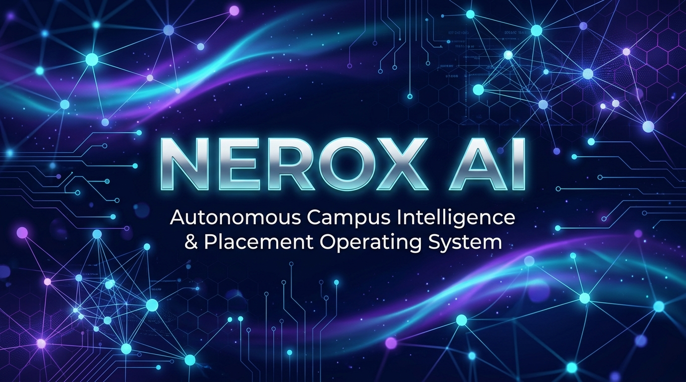
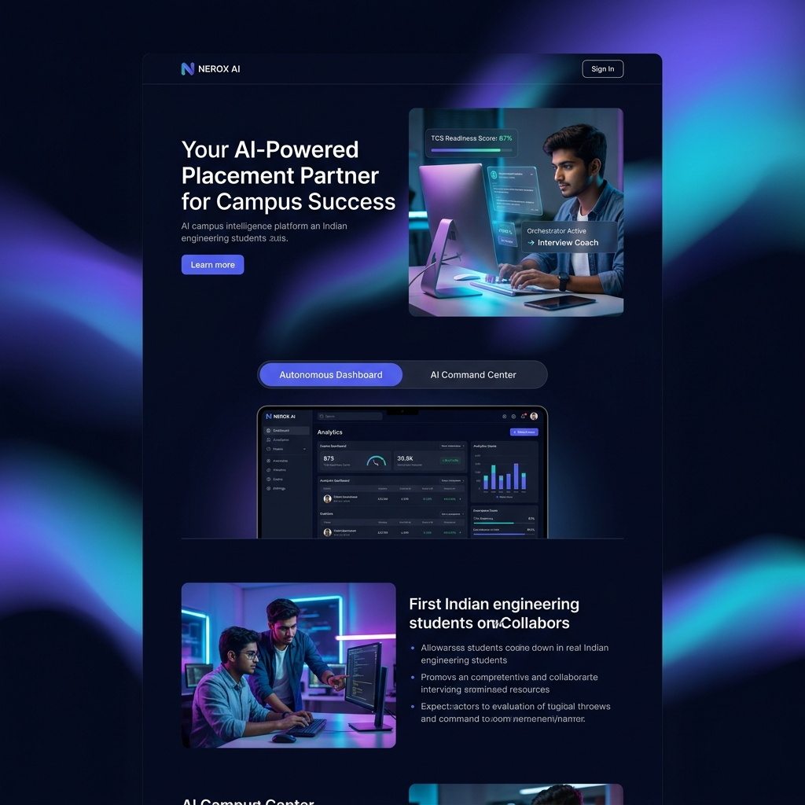
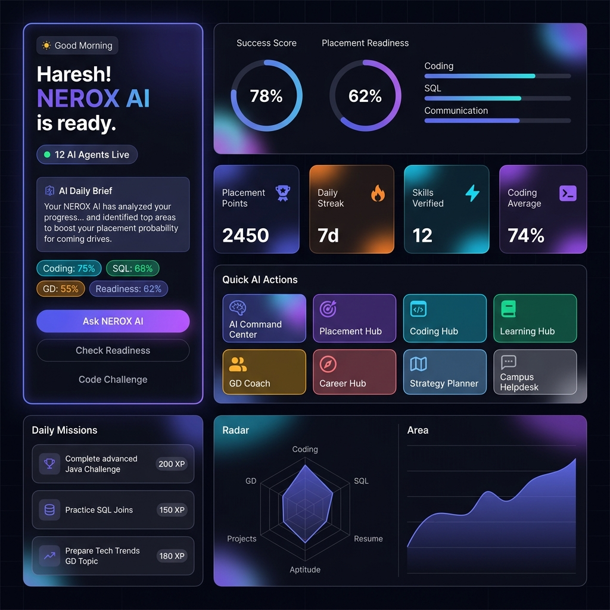
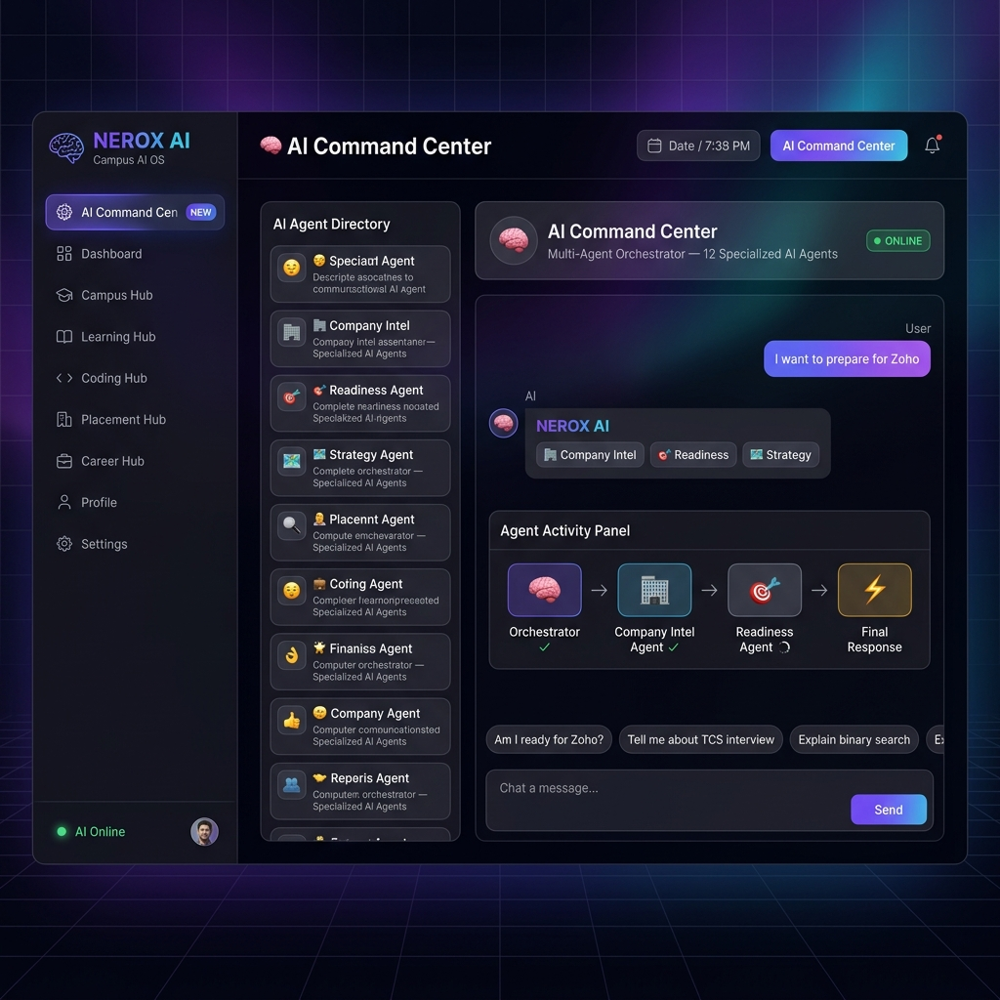
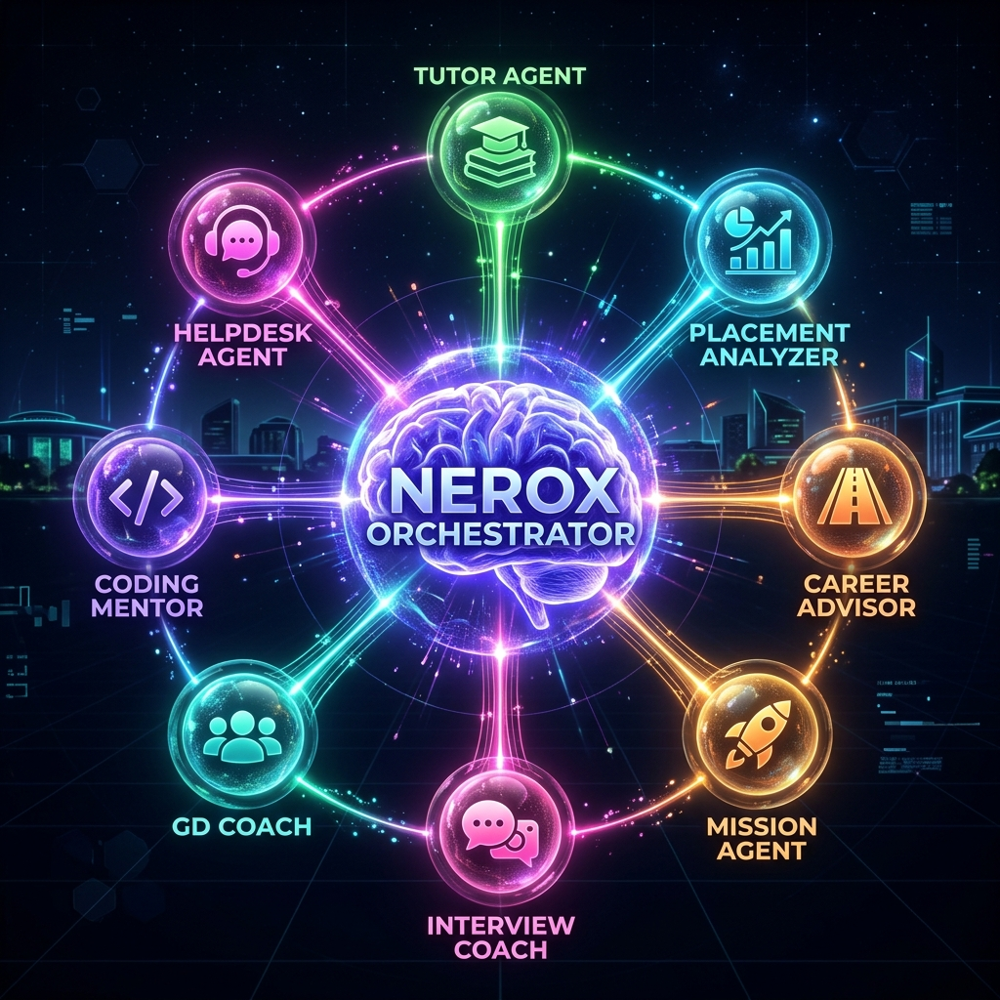

<div align="center">

  

  <br />
  <br />

  ### 🎓 One platform where students, campus operations, and AI work together
  **Autonomous Campus Intelligence & Placement Operating System**

  <br />

  <!-- Tech Stack Badges in for-the-badge style -->
  <p align="center">
    <a href="https://react.dev/"></a>
    <a href="https://nodejs.org/"></a>
    <a href="https://expressjs.com/"></a>
    <a href="https://www.mysql.com/"></a>
    <br />
    <a href="https://ai.google.dev/"></a>
    <a href="https://tailwindcss.com/"></a>
    <a href="https://nerox-ai-qsi9.vercel.app"></a>
    <a href="https://nerox-ai.onrender.com"></a>
    <a href="#-license"></a>
  </p>

  <br />

  <h3>
    <a href="https://nerox-ai-qsi9.vercel.app" target="_blank">🚀 Try the Live Demo</a>
  </h3>

  <!-- Quick Navigation Bar -->
  <p align="center">
    <a href="#-the-problem">Problem</a> •
    <a href="#-the-solution">Solution</a> •
    <a href="#-features">Features</a> •
    <a href="#-screenshots">Screenshots</a> •
    <a href="#-ai-orchestrator--agents">AI Agents</a> •
    <a href="#-system-architecture">Architecture</a> •
    <a href="#-tech-stack">Tech Stack</a> •
    <a href="#-quick-start">Quick Start</a> •
    <a href="#-api-endpoints">API Reference</a> •
    <a href="#-roadmap">Roadmap</a>
  </p>

</div>

---

## 🤕 The Problem

> *"Placements are just 3 months away... I don't know my exact DSA weaknesses, company-specific test patterns, or how to balance daily college attendance with interview prep. Where should I even start?"*

Modern college students and campus placement cells face critical bottlenecks every semester:

- **Fragmented Campus Portals**: Attendance is locked in one legacy portal, exam notices are taped on bulletin boards, and hackathon alerts are buried in noisy WhatsApp groups.
- **One-Size-Fits-All Preparation**: Students solve random coding questions without knowing whether their skills align with dream company hiring standards (Zoho, TCS, Amazon, Infosys).
- **High Counselor-to-Student Ratio**: Students lack 24/7 personal mentors who can debug their code line-by-line, evaluate mock interviews, and tailor 30/60/90-day revision roadmaps.
- **Placement Cell Blindspots**: Placement officers struggle with manual Excel sheets to track real student competency, assess batch readiness, and forecast drive clearances.

---

## 💡 The Solution

**NEROX AI** is an **Autonomous Multi-Agent Campus Intelligence & Placement Operating System** designed to unify student academic life and career acceleration.

- 🤖 **20 Specialized Autonomous AI Agents**: Each dedicated to a single campus or career domain—from debugging code to simulating HR & technical interviews.
- 🧭 **Intelligent Multi-Agent Orchestrator**: Students ask questions in plain English; the orchestrator dynamically analyzes intent and coordinates specialized agents behind the scenes.
- 🎯 **Targeted Company Readiness Engine**: Real-time company readiness scores, adaptive mock tests, Group Discussion coaches, and daily curated missions.
- 🏢 **Unified Campus Hub**: One glassmorphic dashboard for attendance records, smart digital library lookup, and automated event calendars.
- 👔 **Enterprise Placement Officer & Admin OS**: Microsoft Power BI-style dashboard for placement officers to monitor cohort analytics, search student directories, and broadcast company drives.

---

## ✨ Features

### 🎓 1. Student Command Center
- **Dynamic Learning Hub**: Smart Tutor explains complex concepts with intuitive diagrams and interactive examples.
- **Autonomous Coding Hub**: Real-time code execution, syntax/runtime debugging, and Big-O time & space complexity breakdowns.
- **Placement Intelligence Hub**: Tailored readiness scores for Zoho, Amazon, TCS, Infosys, and Cognizant with gap analysis.
- **Interview & GD Coach**: Interactive simulations with real-time feedback on articulation, technical depth, and logic.
- **Daily Prep Missions**: Gamified daily problem sets to build consistency, earn placement points, and maintain streaks.

### 👔 2. Placement Officer Hub (Power BI-Style Analytics)
- **Cohort Health Overview**: Instant KPI metrics on Total Students, Placement Eligible, and Batch Average Readiness.
- **Student Directory**: High-performance paginated table with multi-factor filters (department, year, readiness score) and CSV export.
- **Comprehensive Student Profile**: Granular drill-down into verified skill badges, radar charts, test history, and AI-powered placement forecasts.
- **AI Analytics Agent**: Natural language queries (*"Show students ready for Zoho"*, *"Who needs SQL improvement?"*).
- **Company & Drive Manager**: Post upcoming recruitment drives, eligibility cutoffs, and auto-generate AI company prep guides.

### 🛡️ 3. Super Admin Governance
- **Role-Based Access Control (RBAC)**: Secure multi-role authentication (Student, Placement Officer, Administrator) with JWT & bcrypt.
- **System Audit Trail**: Complete activity logs tracking logins, drive creations, and student updates.
- **Platform Diagnostics**: Live database connectivity status, user counters, and system configuration controls.

---

## 📸 Screenshots

<div align="center">

| 🌟 Modern Landing Page | 🚀 Multi-Agent Student Dashboard |
|:---:|:---:|
|  |  |

| 🧭 Autonomous AI Command Center | 🤖 Multi-Agent Neural Network |
|:---:|:---:|
|  |  |

</div>

---

## 🤖 AI Orchestrator & Agents

Instead of a single generic chatbot, **NEROX AI** deploys an **AI Orchestrator** backed by Google Gemini that classifies incoming student requests and pipelines them through specialized domain agents:

```
                          ┌──────────────────────┐
                          │   Student Request    │
                          │ "Prepare me for Zoho"│
                          └──────────┬───────────┘
                                     │
                                     ▼
                        ┌──────────────────────────┐
                        │   NEROX AI Orchestrator  │
                        │ (Intent & Semantic Gate) │
                        └────────────┬─────────────┘
                                     │
         ┌───────────────────────────┼───────────────────────────┐
         ▼                           ▼                           ▼
┌──────────────────┐       ┌──────────────────┐       ┌──────────────────┐
│  Company Intel   │       │ Company Readiness│       │   Skill Gap      │
│      Agent       │       │      Agent       │       │     Agent        │
└────────┬─────────┘       └────────┬─────────┘       └────────┬─────────┘
         │                          │                          │
         └──────────────────────────┼──────────────────────────┘
                                    │
         ┌──────────────────────────┴──────────────────────────┐
         ▼                                                     ▼
┌──────────────────┐                                 ┌──────────────────┐
│  Coding Mentor   │                                 │Placement Strategy│
│      Agent       │                                 │      Agent       │
└────────┬─────────┘                                 └────────┬─────────┘
         │                                                     │
         └──────────────────────────┬──────────────────────────┘
                                    │
                                    ▼
                      ┌───────────────────────────┐
                      │ Synthesized Unified Guide │
                      │  & Actionable Study Plan  │
                      └───────────────────────────┘
```

### Complete 20-Agent Roster

| Module | Agent | Core Responsibility | AI Engine |
|---|---|---|---|
| **Campus Operations** | **Student Helpdesk Agent** | Campus policies, attendance thresholds, exam rules, hostels, fees | Gemini API |
| | **Smart Timetable Agent** | Daily routines, lab schedules, exam notifications | Gemini API |
| | **Digital Library Agent** | Book availability, textbook summaries, syllabus-recommended reading | Gemini API |
| | **Campus Events Agent** | Hackathons, paper presentations, symposium registrations | Gemini API |
| **Smart Learning** | **Smart Tutor Agent** | Step-by-step conceptual explanations, mathematical proofs, diagrams | Gemini API |
| | **Notes Intelligence Agent** | Document & PDF summarization into flashcards and mind maps | Gemini API |
| | **Assessment Generator** | Custom MCQ, 2-mark, 5-mark, and Viva Voce question papers | Gemini API |
| | **Revision Planner Agent** | Spaced-repetition revision plans tailored to semester syllabi | Gemini API |
| **Coding & Algorithms** | **Coding Mentor Agent** | Code walkthroughs, Big-O optimization, and clean refactoring | Gemini API |
| | **Autonomous Debug Agent** | Instant bug diagnosis, logical edge-case catches, corrected patches | Gemini API |
| | **Coding Test Generator** | Company-pattern coding challenges with hidden test cases | Gemini API |
| | **Coding Evaluation Agent** | Automated code quality, naming convention, and complexity scoring | Gemini API |
| **Placement Intel** | **Company Intel Agent** | Hiring workflows, package breakdowns, and past interview questions | Gemini API |
| | **Company Readiness Agent** | Quantified student readiness percentage for specific companies | Gemini API |
| | **Interview Coach Agent** | Adaptive technical and behavioral mock interview sessions | Gemini API |
| | **GD Coach Agent** | Group Discussion topic simulations and articulation feedback | Gemini API |
| | **Placement Strategy Agent**| 30, 60, and 90-day customized placement acceleration roadmaps | Gemini API |
| | **Daily Mission Agent** | Curated daily aptitude, core CS, and DSA problems | Gemini API |
| **Career Discovery** | **Career Advisor Agent** | Personalized career tracks (Full-Stack, DevOps, Data Science, AI) | Gemini API |
| | **Skill Gap Agent** | Current profile delta vs. live target industry requirements | Gemini API |

---

## 🏗️ System Architecture

```
nerox-ai/
├── frontend/                     # React 18 + Vite + TypeScript (Client Application)
│   ├── src/
│   │   ├── api/                 # Axios HTTP client configured with JWT interceptors
│   │   ├── components/          # Reusable glassmorphic UI cards, charts, navigation
│   │   │   ├── layout/          # Responsive Sidebar, Navbar, PageWrappers
│   │   │   └── ui/              # Animated Buttons, Badges, Modals, Progress Sliders
│   │   ├── context/             # Global AuthContext & AgentActivityProvider
│   │   ├── pages/               # Multi-role routing views
│   │   │   ├── admin/           # Super Admin system governance & user auditor
│   │   │   └── officer/         # Placement Officer analytics, directories & company drives
│   │   └── types/               # TypeScript interfaces & API contract models
│   ├── vercel.json              # Production client-side routing & reverse-proxy config
│   └── package.json
│
├── backend/                      # Node.js + Express.js REST API Server
│   ├── src/
│   │   ├── config/              # MySQL connection pool & Google Gemini SDK service
│   │   ├── controllers/         # Authentication, Officer, Company, Notification controllers
│   │   ├── middleware/          # Role-based access control (requireRole) & JWT verify
│   │   ├── routes/              # Express API endpoints
│   │   └── services/            # Multi-agent orchestrator & individual agent prompts
│   ├── migrate.js               # Database schema initialization script
│   └── package.json
│
├── docs/                         # Documentation assets
│   ├── nerox-banner.png         # High-resolution banner
│   └── nerox-banner.svg         # Scalable vector banner
│
└── assets/                      # Repository visual assets & screenshots
    ├── banner.png               # High-resolution header banner
    ├── banner.svg               # Vector banner
    └── screenshots/             # Production UI screenshots
```

---

## 🛠️ Tech Stack

| Domain | Technology | Purpose |
|:---:|:---:|:---|
| **Frontend Framework** | **React 18 (Vite)** | Blazing-fast client rendering with hot module replacement |
| **Language** | **TypeScript** | Strict compile-time type safety across client interfaces |
| **Styling & Motion** | **Tailwind CSS + Framer Motion** | Dark Aurora glassmorphism with fluid micro-interactions |
| **Data Visualization** | **Recharts** | Radar charts, KPI bars, area curves, and cohort distributions |
| **Backend Runtime** | **Node.js + Express.js** | Modular RESTful API server with robust error handling |
| **Database** | **MySQL (Clever Cloud)** | Scalable relational storage with automatic startup migrations |
| **Artificial Intelligence** | **Google Gemini API** | Multi-agent reasoning, semantic routing, and code optimization |
| **Security & Auth** | **JWT + bcrypt** | Token-based stateless authentication with role-based guards |
| **Cloud Deployment** | **Vercel (Client) + Render (API)**| High-availability edge hosting with CI/CD GitHub integration |

---

## 🚀 Quick Start

### 📋 Prerequisites
- **Node.js**: `v18.0.0` or higher
- **npm**: `v9.0.0` or higher
- **MySQL Database**: Local or remote (e.g. Clever Cloud / Aiven)
- **Google Gemini API Key**: [Get your free key from Google AI Studio](https://aistudio.google.com/apikey)

---

### 1️⃣ Clone the Repository

```bash
git clone https://github.com/HareshK-14/NEROX-AI.git
cd NEROX-AI
```

---

### 2️⃣ Configure & Start Backend

```bash
cd backend
npm install
```

Create a `.env` file in the `backend/` folder:

```env
PORT=5000
NODE_ENV=development
CLIENT_URL=http://localhost:5173
DB_HOST=localhost
DB_USER=root
DB_PASSWORD=your_mysql_password
DB_NAME=nerox_ai
DB_PORT=3306
JWT_SECRET=your_super_secret_jwt_key
JWT_EXPIRES_IN=7d
GEMINI_API_KEY=your_gemini_api_key_here
UPLOAD_DIR=uploads
```

Run database migrations and launch the backend server:

```bash
node migrate.js
npm run dev
```
> Server running at: `http://localhost:5000`

---

### 3️⃣ Configure & Start Frontend

Open a **new terminal** window:

```bash
cd frontend
npm install --legacy-peer-deps
npm run dev
```
> Application running at: `http://localhost:5173`

---

## 📡 API Endpoints

<details>
<summary><b>Click to expand full REST API specification</b></summary>

<br />

#### 🔐 Authentication & Roles
- `POST /api/auth/register` - Register a new account (`student`, `placement_officer`, `admin`)
- `POST /api/auth/login` - Authenticate credentials and receive JWT
- `GET  /api/auth/me` - Fetch authenticated user profile and permissions

#### 🧠 AI Orchestrator
- `POST /api/orchestrator/query` - Semantic multi-agent classification and unified execution
- `POST /api/ai/agent-action` - Direct execution of any of the 20 specialized agents

#### 👔 Placement Officer Analytics
- `GET  /api/officer/overview` - Batch KPIs (Total Students, Placement Eligible, At-Risk Counts)
- `GET  /api/officer/students` - Paginated student directory with search, filter, and sort
- `GET  /api/officer/students/:id` - In-depth student profile with AI placement probability forecast
- `POST /api/officer/ai-analytics` - Natural language queries on cohort performance

#### 🏢 Companies & Drives
- `GET  /api/companies` - List all recruiting companies and eligibility criteria
- `POST /api/companies` - Register a new company and schedule recruitment drives
- `POST /api/companies/:id/ai-prep` - Auto-generate AI company-specific preparation guides

#### 📢 Announcements
- `GET  /api/notifications` - Retrieve targeted student/officer notices
- `POST /api/notifications` - Broadcast drive announcements to specific departments

</details>

---

## 🗺️ Roadmap

- [x] Multi-Agent Architecture with 20 dedicated agents & Gemini integration
- [x] Dark Aurora Glassmorphism UI with Tailwind CSS & Framer Motion
- [x] Complete Role-Based Access Control (Student, Placement Officer, Super Admin)
- [x] Placement Officer Power BI-style analytics suite with Recharts
- [x] Cloud deployment on Vercel (Frontend) and Render (Backend + Clever Cloud MySQL)
- [ ] Voice-based interactive Mock Interviews with Speech-to-Text
- [ ] Automated resume ATS scoring and keyword optimizer
- [ ] Mobile application (React Native) for real-time drive notifications

---

## 🤝 Contributing

Contributions are welcomed! Follow these steps to contribute:

1. Fork the Project
2. Create your Feature Branch (`git checkout -b feature/AmazingFeature`)
3. Commit your Changes (`git commit -m 'Add some AmazingFeature'`)
4. Push to the Branch (`git push origin feature/AmazingFeature`)
5. Open a Pull Request

---

## 📄 License

Distributed under the **MIT License**. See `LICENSE` for more information.

---

<div align="center">
  <sub>Built with ❤️ by <a href="https://github.com/HareshK-14">Haresh K</a> • Autonomous Campus Intelligence OS</sub>
</div>
